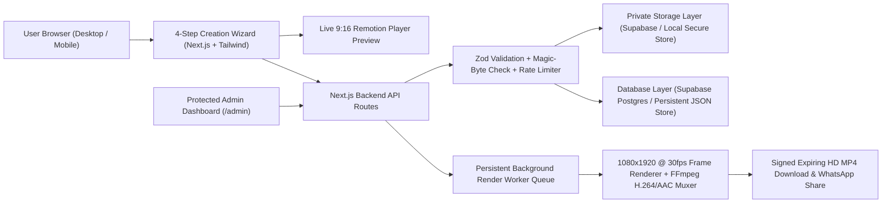

# 🪷 ShubhVivah Studio — Animated Indian Wedding Invitation Video Maker

[](https://nextjs.org/)
[](https://www.typescriptlang.org/)
[](https://www.remotion.dev/)
[](https://ffmpeg.org/)
[](https://tailwindcss.com/)

**ShubhVivah Studio** is a complete, production-ready web application where users can create **1080×1920 Full HD (9:16 vertical, 30 FPS, H.264 + AAC)** animated Indian wedding invitation MP4 videos simply by selecting a template, entering their wedding & ceremony details, uploading couple photos, and choosing a background song — with **zero video editing skills required**.

---

## 🎯 User Journey

1. **Visit the Website** — Preview live 9:16 animated invitations and explore the template gallery.
2. **Select a Wedding Invitation Template** — Choose from 4 handcrafted Indian cultural themes and select **English**, **Hindi (`हिंदी`)**, or **Bilingual Mixed** typography.
3. **Enter Bride, Groom & Ceremony Details** — Add couple names, parents' blessings, main wedding date/time/venue/address/Google Maps URL, and toggle or reorder ceremonies (*Haldi*, *Mehndi*, *Sangeet*, *Engagement*, *Reception*, or custom ceremonies).
4. **Upload & Frame Couple Photos** — Upload `JPG`, `PNG`, or `WebP` portraits with interactive **Zoom**, **Pan (X/Y)**, and optional **Studio Portrait Cutout Halo** controls so faces are never stretched or distorted.
5. **Select or Upload Background Music** — Pick from 4 built-in royalty-free Indian classical/folk tracks or upload your own `MP3`/`WAV` song, set the start time offset and volume, and preview live.
6. **Click "Create My Wedding Video"** — Our persistent background worker renders a real **1080×1920 @ 30 FPS H.264 + AAC MP4** video with a 2s audio fade-in and 2.5s fade-out.
7. **Download HD MP4 & Share on WhatsApp** — Watch the rendered MP4, download it for WhatsApp Status / Instagram Reels, or share a public/private RSVP invitation link.

---

## 🎨 4 Original Animated Wedding Video Templates

| Template | Theme & Colors | Cultural Motifs & Animations |
| :--- | :--- | :--- |
| **1. Royal Wedding** (`royal-wedding`) | Deep Maroon (`#4A0715`) & 24k Gold (`#D4AF37`) | Rotating golden mandala, sacred Ganesh Ji invocation, royal palace arches, shimmering golden particles |
| **2. Floral Wedding** (`floral-wedding`) | Warm Ivory Cream (`#FFF9F6`) & Pastel Blush Rose (`#FADADD`) | Botanical floral arches, swinging brass wedding lanterns, floating rose petals |
| **3. Haldi & Mehndi** (`haldi-mehndi`) | Sunlit Ivory (`#FFFBEB`) & Marigold Amber (`#F59E0B`) | Hanging *genda phool* (marigold) garlands, cascading yellow petals, festive transitions |
| **4. Traditional Indian Wedding** (`traditional-indian`) | Sacred Emerald (`#064E3B`), Ivory & Temple Gold | Royal peacocks, swinging brass temple bells (*ghanti*), sacred wedding mandap |

---

## 🎬 Dynamic 9-Scene Video Sequence (45–65 Seconds)

Unused ceremonies are automatically skipped and total duration is dynamically normalized between **45 and 65 seconds** at **30 FPS**:

- **Scene 1**: Sacred Ganesh Ji introduction (`॥ श्री गणेशाय नमः ॥`) with rotating golden mandala and floating particles.
- **Scene 2**: *"Shubh Vivah"* / *"Wedding Invitation"* royal title reveal with ornamental borders.
- **Scene 3**: Bride & Groom names with circular and royal-arch portrait reveals + wedding hashtag.
- **Scene 4**: Animated family invitation message and parents' blessings.
- **Scene 5**: *Haldi Ceremony* details with marigold decorations *(if enabled)*.
- **Scene 6**: *Mehndi Ceremony* details with decorative designs *(if enabled)*.
- **Scene 7**: *Sangeet / Engagement / Reception / Custom* ceremony details *(if enabled, in user's exact order)*.
- **Scene 8**: Main Wedding Date, Time, Venue, Address, and Couple photograph inside an ornate Mandap frame.
- **Scene 9**: Final invitation message, RSVP family names, contact number, and thank-you animation.

---

## 🏗️ Architecture & Tech Stack



- **Frontend**: Next.js 14 (App Router), TypeScript, Tailwind CSS, Lucide Icons, Google Fonts (`Cormorant Garamond`, `Cinzel Decorative`, `Plus Jakarta Sans`, `Noto Serif Devanagari`).
- **Live Browser Preview**: `@remotion/player` (`1080×1920`, `30 FPS`) with interactive scene jump pills.
- **Server-Side MP4 Rendering Engine**: `@napi-rs/canvas` 1080×1920 frame renderer piped into `ffmpeg-static` (`libx264`, `yuv420p`, `30fps` + `aac` `192k` stereo audio with automatic loop, trim offset, 2s fade-in, and 2.5s fade-out), with automatic serverless binary provisioning in `os.tmpdir()`.
- **Database & Private Object Storage**: Serverless-safe storage engine (`src/lib/storage/objectStorage.ts` + `src/lib/db/store.ts`) supporting **Supabase PostgreSQL + Private Storage Buckets** (`private-photos`, `custom-audio`, `rendered-videos`) and persistent local storage outside `/var/task`, using `os.tmpdir()` with automatic cleanup for temporary FFmpeg working files.

---

## 🚀 Quick Start (Local Development)

### 1. Clone & Install Dependencies
```bash
git clone https://github.com/nitish409/wedding-invitation-maker.git
cd wedding-invitation-maker
npm install
```

### 2. Generate Royalty-Free Wedding Audio & Sample Portraits
```bash
npm run setup:assets
```
*(Synthesizes 4 full-length 68-second royalty-free Indian wedding `.wav` tracks in `public/audio/` and 4 sample portraits in `public/samples/`).*

### 3. Configure Environment Variables
```bash
cp .env.example .env.local
```

### 4. Start the Development Server
```bash
npm run dev
```
- Open **([https://wedding-invitation-maker-yha4.vercel.app/](https://wedding-invitation-maker-yha4.vercel.app/))** in your browser:
  

---

## 🧪 Automated End-to-End Verification

With the server running on `http://localhost:3000`, run:
```bash
npm run test:e2e
```
This script verifies:
1. All 4 templates and 4 royalty-free audio tracks load via `GET /api/projects`.
2. Spoofed/invalid binary file uploads are rejected with `HTTP 400`.
3. Sample Bride, Groom, and Couple photos upload to private storage and return HMAC-signed media URLs.
4. Creating a project with Haldi & Wedding ceremonies enqueues a background render job.
5. Polling `GET /api/jobs/[id]` progresses to `100% COMPLETED`.
6. Downloading the output MP4 via `GET /api/download/[id]` yields a valid `1080×1920`, `30 FPS`, `H.264 + AAC` video verified by FFmpeg stream inspection.
7. Edge cases (missing optional ceremonies, long Hindi/English names) and Admin authentication (`401` vs `200`).

---

## 🔐 Environment Variables (`.env.example`)

| Variable | Default | Description |
| :--- | :--- | :--- |
| `NEXT_PUBLIC_APP_URL` | `http://localhost:3000` | Base URL for WhatsApp share links & signed URLs |
| `ADMIN_PASSCODE` | `shubhvivah-admin-2026` | Passcode to access `/admin` dashboard |
| `DOWNLOAD_SIGNING_SECRET` | `shubhvivah-hmac-...` | HMAC-SHA256 secret for expiring video & private photo links |
| `STORAGE_MODE` | `local` | `local` (default persistent store) or `supabase` |
| `NEXT_PUBLIC_SUPABASE_URL` | — | Supabase project URL (when `STORAGE_MODE=supabase`) |
| `NEXT_PUBLIC_SUPABASE_ANON_KEY` | — | Supabase anon key |
| `SUPABASE_SERVICE_ROLE_KEY` | — | Supabase service role key |
| `DEFAULT_VIDEO_WIDTH` | `1080` | Default render width in pixels |
| `DEFAULT_VIDEO_HEIGHT` | `1920` | Default render height in pixels |
| `DEFAULT_VIDEO_FPS` | `30` | Default render frame rate |
| `DOWNLOAD_LINK_EXPIRY_HOURS` | `72` | Hours before signed MP4 download links expire |

See [DEPLOYMENT.md](./DEPLOYMENT.md) for production hosting and Supabase setup instructions.
